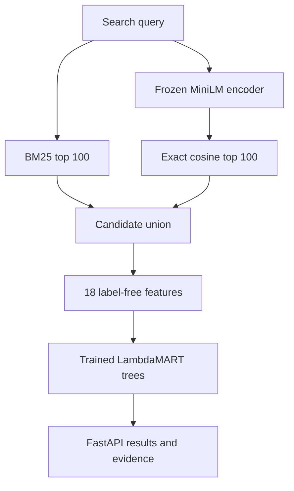

# Architecture

The same Python engine powers evaluation, HTTP search, and smoke checks. The browser renders results from the API. It does not make up rankings or run a different search algorithm.

## Why this design

- **Exact dense search** is appropriate for 42,994 products. It avoids approximation error and an unnecessary external vector database. NumPy performs a normalized matrix-vector multiply. Moving to millions of products would justify an ANN index such as FAISS or HNSW.
- **BM25** preserves precise word and number matches that dense retrieval can overlook. Its postings store precomputed BM25 contributions, keeping query-time work proportional to matching postings.
- **MiniLM** provides semantic similarity without a paid API. A pinned quantized ONNX export reduces CPU and deployment cost. Attention-mask mean pooling excludes padded tokens and embeddings are L2-normalized. Input is truncated to 128 subword tokens.
- **LambdaMART** provides a supervised ranking component suited to a small labeled dataset. It can learn combinations of cosine similarity, lexical coverage, and attribute conflicts without fine-tuning a much larger language model.
- **Portable tree inference** removes the training framework from production dependencies. A committed parity fixture checks predictions against LightGBM, and tests exercise that contract.
- **No database** is needed for this read-only snapshot. Artifact revisions, checksums, and an explicit rebuild keep the deployment auditable.

## Boundaries

`text.py`, `features.py`, and `retrieval.py` are shared by training and serving. Labels are read by the training and evaluation scripts, never by `SearchEngine`. The query's human-assigned `query_class` is never an input feature. Ratings are displayed as catalogue metadata and are not a ranking feature.

The runtime performs inference only. The bootstrap script downloads public immutable inputs and builds the catalogue index and embeddings before serving traffic. The trained reranker and evaluation report are committed. A deployment rebuild does not silently retrain or inspect test labels to tune the model.

## Serving behavior

One process holds an immutable corpus and index, a bounded query embedding cache, and a bounded product-token cache. Initialization is serialized to avoid duplicate model loads. Search execution is serialized per process to keep CPU and memory bounded. Multiple server instances have independent caches. This design is for an interactive portfolio workload, not a high-throughput multi-tenant search service.

`/api/health` verifies artifact presence without executing expensive inference. `/api/search` bounds query length, result count, mode, and category length. `/api/evaluation` serves the committed benchmark. OpenAPI is available at `/docs`.

## Next experiments

A cross-encoder reranker, a fine-tuned bi-encoder, stronger query-family clustering, and more human judgments would be useful controlled experiments. They are not implemented results. Online A/B testing would be required before claiming impact on conversion or revenue.
